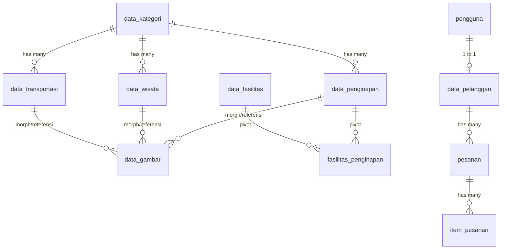

# Panduan Migrasi: Info Wisata Guci (CodeIgniter 3 ke Laravel)

Dokumen ini berisi rangkuman komprehensif arsitektur, basis data, alur bisnis, serta peta migrasi dari CodeIgniter 3 ke Laravel (versi 10.x / 11.x).

---

## 1. Ikhtisar Arsitektur & Teknologi Saat Ini (CI3)

* **Framework**: CodeIgniter 3.x (PHP 7.4 / 8.x kompatibel)
* **CSS Framework**: Tailwind CSS (CDN Runtime) + Font Awesome + Google Fonts (Poppins)
* **Frontend Utilities**: jQuery, SortableJS (drag-and-drop urutan), CompressorJS
* **Database Driver**: MySQL / MariaDB (Query Builder CI3)
* **Aset Publik**:
  - `uploads/penginapan/` : Foto & thumbnail penginapan (JPG/PNG + WebP)
  - `uploads/wisata/` : Foto & thumbnail wisata (JPG/PNG + WebP)
  - `uploads/transportasi/` : Foto & thumbnail transportasi
  - `uploads/icon/` : Ikon kategori & fasilitas
  - `assets/` : Logo dan aset statis UI

---

## 2. Struktur Database & Model Relasi

Berdasarkan analisis controller, model (`MAdmin`, `MPelanggan`), dan query builder, berikut skema tabel yang perlu dibuatkan file Migration di Laravel:



### Rincian Tabel:

1. **`pengguna` (Users)**
   - `id` (PK, INT Auto Increment)
   - `nama` (VARCHAR)
   - `email` (VARCHAR, Unique)
   - `password` (VARCHAR, Hash BCRYPT)
   - `role` (ENUM: `'admin'`, `'pelanggan'`)
   - `created_at`, `updated_at` (TIMESTAMP)

2. **`data_pelanggan` (Customers)**
   - `id` (PK, INT Auto Increment)
   - `id_pengguna` (FK ke `pengguna.id`, nullable/cascade)
   - `nama` (VARCHAR)
   - `nomor_telepon` / `no_hp` (VARCHAR)
   - `alamat` (TEXT, nullable)
   - `created_at`, `updated_at` (TIMESTAMP)

3. **`data_kategori` (Categories)**
   - `id` (PK)
   - `nama` (VARCHAR)
   - `icon` (VARCHAR)
   - `status` (ENUM: `'aktif'`, `'nonaktif'`)
   - `created_at`, `updated_at`

4. **`data_fasilitas` (Facilities)**
   - `id` (PK)
   - `nama` (VARCHAR)
   - `icon` (VARCHAR)
   - `status` (ENUM: `'aktif'`, `'nonaktif'`)
   - `created_at`, `updated_at`

5. **`data_penginapan` (Accommodations)**
   - `id` (PK)
   - `id_kategori` (FK ke `data_kategori.id`)
   - `nama` (VARCHAR)
   - `thumbnail` (VARCHAR)
   - `deskripsi` (TEXT)
   - `kapasitas_min` (INT)
   - `kapasitas_max` (INT)
   - `harga_weekday` (DECIMAL / INT)
   - `harga_weekend` (DECIMAL / INT)
   - `harga_high_season` (DECIMAL / INT)
   - `urutan` (INT, default 0 - untuk sorting drag-and-drop)
   - `status` (ENUM: `'aktif'`, `'nonaktif'`)
   - `created_at`, `updated_at`

6. **`fasilitas_penginapan` (Pivot Accommodations <-> Facilities)**
   - `id` (PK)
   - `id_pengguna` / `id_penginapan` (FK ke `data_penginapan.id`)
   - `id_fasilitas` (FK ke `data_fasilitas.id`)

7. **`data_wisata` (Attractions / Tours)**
   - `id` (PK)
   - `id_kategori` (FK ke `data_kategori.id`)
   - `nama` (VARCHAR)
   - `thumbnail` (VARCHAR)
   - `deskripsi` (TEXT)
   - `harga_weekday` (INT)
   - `harga_weekend` (INT)
   - `harga_high_season` (INT)
   - `urutan` (INT, default 0)
   - `status` (ENUM: `'aktif'`, `'nonaktif'`)
   - `created_at`, `updated_at`

8. **`data_transportasi` (Transportation)**
   - `id` (PK)
   - `id_kategori` (FK)
   - `nama` (VARCHAR)
   - `thumbnail` (VARCHAR)
   - `deskripsi` (TEXT)
   - `harga_weekday`, `harga_weekend`, `harga_high_season` (INT)
   - `urutan` (INT)
   - `status` (ENUM)

9. **`data_gambar` (Gallery Images)**
   - `id` (PK)
   - `id_referensi` (INT - ID penginapan / wisata / transportasi)
   - `jenis_referensi` (VARCHAR - `'penginapan'`, `'wisata'`, `'transportasi'`)
   - `gambar` (VARCHAR)
   - *Rekomendasi Laravel: Gunakan Polymorphic Relation (`imageable_id`, `imageable_type`)*.

---

## 3. Logika Bisnis & Fitur Kunci

### A. Dynamic Pricing / Tarif Helper (`tarif_helper.php`)
Sistem menghitung tarif secara dinamis berdasarkan tanggal kunjungan:
- **Weekday**: Senin - Jumat.
- **Weekend**: Sabtu - Minggu.
- **High Season**: Berdasarkan rentang tanggal kalender libur nasional di `config/kalender_indonesia.php` (misal libur Idul Fitri, Natal/Tahun Baru).
- *Di Laravel*: Buat `App\Services\PricingService` atau method helper/attribute di Model.

### B. Pemesanan via WhatsApp
Saat ini pemesanan langsung diteruskan ke WhatsApp CS (`CPelanggan::tarif_pemesanan()`):
- Format pesan dinamis: Nama item, tanggal kunjungan, jenis tarif, dan nominal rupiah.
- URL target: `https://wa.me/6287830270670?text=...`

### C. Drag and Drop Ordering (`SortableJS`)
Di halaman admin (Penginapan & Wisata), terdapat fitur sorting posisi tampilan untuk beranda menggunakan AJAX request ke method `update_urutan`.

### D. Kompresi Gambar Client-Side & WebP
- Di form admin: menggunakan `CompressorJS` sebelum upload (dikirim sebagai base64 / multipart).
- Di sisi server: seluruh gambar disajikan dengan format WebP via helper `image_webp_url()`.

---

## 4. Pemetaan Routing (CI3 ke Laravel `routes/web.php`)

| Metode | URI CI3 | Controller & Action CI3 | Usulan Route Laravel |
|---|---|---|---|
| GET | `/` / `/beranda` | `CPages@pelanggan` | `HomeController@index` (`'home'`) |
| GET | `/penginapan` | `CPelanggan@penginapan_page` | `AccommodationController@index` |
| GET | `/penginapan/detail/{id}` | `CPelanggan@detail_penginapan_page` | `AccommodationController@show` |
| GET | `/wisata` | `CPelanggan@wisata_page` | `DestinationController@index` |
| GET | `/wisata/detail/{id}` | `CPelanggan@detail_wisata_page` | `DestinationController@show` |
| GET | `/transportasi` | `CPelanggan@transportasi_page` | `TransportationController@index` |
| GET | `/transportasi/detail/{id}` | `CPelanggan@detail_transportasi_page` | `TransportationController@show` |
| GET/POST | `/login` | `CAuth@index` | `AuthController@login` (Breeze/Fortify) |
| GET/POST | `/register` | `CAuth@register` | `AuthController@register` |
| GET | `/logout` | `CAuth@logout` | `AuthController@logout` |
| **ADMIN** | | *(Prefix: `/admin`, Middleware: `auth, role:admin`)* | |
| GET | `/admin/dashboard` | `CPages@admin` | `Admin\DashboardController@index` |
| CRUD | `/admin/data-wisata` | `CDataWisata` | `Admin\DestinationController` (Resource) |
| POST | `/admin/data-wisata/hapus_gambar` | `CDataWisata@hapus_gambar` | `Admin\DestinationImageController@destroy` |
| CRUD | `/admin/data-penginapan` | `CDataPenginapan` | `Admin\AccommodationController` (Resource) |
| CRUD | `/admin/data-transportasi` | `CDataTransportasi` | `Admin\TransportationController` (Resource) |
| CRUD | `/admin/data-kategori` | `CDataKategori` | `Admin\CategoryController` (Resource) |
| CRUD | `/admin/data-fasilitas` | `CDataFasilitas` | `Admin\FacilityController` (Resource) |

---

## 5. Rekomendasi Arsitektur di Laravel

1. **Autentikasi**:
   - Gunakan **Laravel Breeze** (Blade + Tailwind) agar styling Tailwind yang sudah ada di CI3 bisa langsung dipindahkan dengan mudah.
   - Buat Middleware `RoleMiddleware` untuk mengecek `$user->role === 'admin'`.

2. **Model & Relasi (Eloquent)**:
   - `Accommodation` (Penginapan) `belongsTo(Category::class)`, `belongsToMany(Facility::class)`, `morphMany(Image::class)`.
   - `Destination` (Wisata) `belongsTo(Category::class)`, `morphMany(Image::class)`.
   - `Image` (Data Gambar) polymorphic relation `imageable()`.

3. **Manajemen Upload Media**:
   - Gunakan disk `public` (`storage/app/public`).
   - Buat helper / `Intervention Image v3` untuk otomatis generate WebP dan resize saat admin upload gambar:
     ```php
     Image::read($file)->scaleDown(width: 1000)->toWebp(80)->save($path);
     ```

4. **Blade Templating**:
   - Pindahkan `application/views/components/header.php`, `navbar.php`, `footer_pelanggan.php` ke `resources/views/layouts/app.blade.php`.
   - Pindahkan `sidebar_admin.php` ke `resources/views/layouts/admin.blade.php`.
